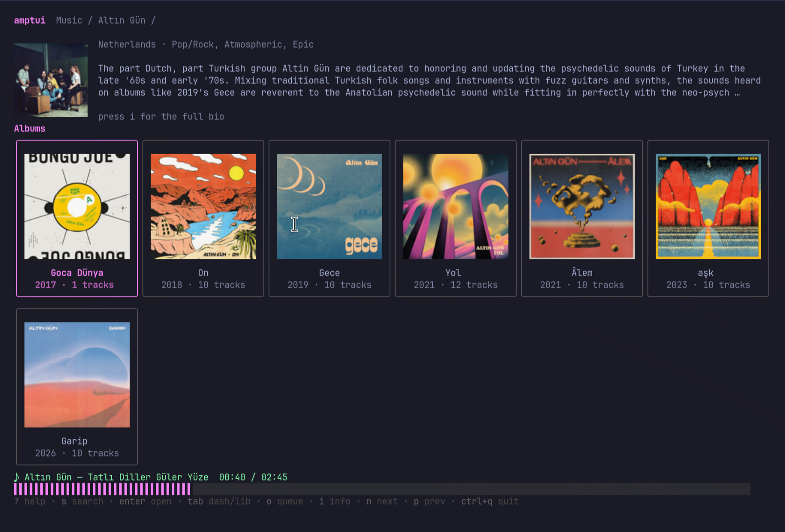

# amptui

A terminal UI music client for Plex and Jellyfin — browse your library,
queue tracks, and play them, all from the keyboard.

Built with [Bubble Tea](https://github.com/charmbracelet/bubbletea), small
hand-written Plex and Jellyfin HTTP clients behind a common backend
interface, and [mpv](https://mpv.io/) for audio playback.



## Status

Working today:

- [x] Connect to a Plex server (manual token auth) or a Jellyfin server (username/password)
- [x] Browse: libraries → artists → albums → tracks (list or grid)
- [x] Plex-style sorting per level (`o`) — title, year, date added, duration, counts — remembered across launches
- [x] Dashboard home with recent plays, recently added, recent playlists
- [x] Play via mpv: pause/resume, seek, next/prev, volume/mute, repeat, shuffle, queue with auto-advance
- [x] Queue and position restored (paused) on the next launch
- [x] OS media controls (Linux, MPRIS): media keys, `playerctl`, and bar / notification widgets show what's playing and drive it
- [x] Queue modal: reorder, delete, jump-to-play, track progress bar
- [x] Downloads (`d` / `D`) with live per-file progress and transfer rate, and a quality preset — original file or server-side MP3
- [x] Fuzzy search across the whole library
- [x] Artist / album info: bio, genres, similar artists (`i` modal)
- [x] Inline artwork — Kitty graphics on supported terminals, [chafa](https://hpjansson.org/chafa/) when installed, half-block fallback everywhere else; lazy-loaded for the on-screen window only
- [x] Editable settings screen, in-app keybindings modal (`?`)
- [x] Pluggable backend — Plex or Jellyfin, selected by config, behind one `media.Backend` interface
- [x] Library cache (`internal/library`) as single source of truth — browse + search read from it; the server is only touched during sync or info fetches
- [x] Playback reporting: shows in the server's Now Playing, counts plays (feeds "Recent plays")

## Roadmap

- **Dashboard improvements** — richer tiles, more sections, better layout.
- **Playlist management** — create, edit, and reorder playlists from the TUI
  (today they're browse + play only).
- **Music visualizer screen** — an audio-reactive view while a track plays.

## Requirements

- Go 1.26.8+
- [mpv](https://mpv.io/) on your `PATH` (playback is disabled gracefully if missing)
- A music library on either a Plex Media Server (with an `X-Plex-Token`) or a
  Jellyfin server (with a username + password)

## Build

```bash
make build     # produces ./amptui
make run       # build-and-run via `go run`
make install   # install to ~/.local/bin so `amptui` is on PATH
make uninstall # remove the installed binary
make           # list all targets
```

`make install` writes to `~/.local/bin`; override with
`make install BINDIR=/usr/local/bin`. It intentionally avoids `go install`,
which obeys `$GOBIN` — version managers like mise point that inside the
versioned Go toolchain directory, so the binary drops off `PATH` as soon as
the Go version changes.

Without `make`: `go build -o amptui ./cmd/amptui && ./amptui`, or `go run ./cmd/amptui`.

## Configuration

Every setting is editable from inside the app — press `,` to open the
settings screen, `j`/`k` to move, `enter` to edit, `enter` again to save.
First-run with no config drops you straight there so you can pick a backend
and paste in your credentials.

Settings (the required ones depend on the backend — see below):

| Setting             | TOML key              | Values                  | Notes                                                                |
| ------------------- | --------------------- | ----------------------- | -------------------------------------------------------------------- |
| Backend             | `backend`             | `plex` / `jellyfin`     | Which server type to drive. Defaults to `plex`.                      |
| Server URL          | `server_url`          | `http://host:32400`     | Your server. Required. (Jellyfin is usually port `8096`.)            |
| Plex token          | `plex_token`          | `X-Plex-Token`          | **Plex only.** See Plex's [auth token guide](https://support.plex.tv/articles/204059436-finding-an-authentication-token-x-plex-token/). |
| Jellyfin username   | `jellyfin_username`   | account name            | **Jellyfin only.**                                                   |
| Jellyfin password   | `jellyfin_password`   | account password        | **Jellyfin only.** Exchanged for a token + user id at startup.       |
| Default library     | `default_library`     | name or section key     | Skips the library picker on launch.                                  |
| Default view artist | `default_view_artist` | `list` / `grid`         | Initial render mode for the Artists level.                           |
| Default view album  | `default_view_album`  | `list` / `grid`         | Initial render mode for the Albums level.                            |
| Home screen         | `home`                | `library` / `dashboard` | Which screen amptui opens on. `tab` toggles at runtime.              |
| Inline artwork      | `images`              | `false` / `true`        | Render artist / album thumbnails. See [Inline artwork](#inline-artwork). |
| Download folder     | `download_folder`     | path                    | Where `d` saves tracks/albums. Empty disables downloads.            |
| Download quality    | `download_quality`    | `original` / `mp3-NNN`  | What `d` asks the server for. See [Downloads](#downloads).          |
| Report playback     | `report_playback`     | `true` / `false`        | Now Playing + play counts on the server. On by default. See [Playback reporting](#playback-reporting). |
| Sort (artists)      | `sort_artist`         | `<field>:<direction>`   | Artist ordering. Written by the `o` modal. See [Sorting](#sorting). |
| Sort (albums)       | `sort_album`          | `<field>:<direction>`   | Album ordering.                                                     |
| Sort (tracks)       | `sort_track`          | `<field>:<direction>`   | Track ordering.                                                     |

**Plex** needs `server_url` + `plex_token`. **Jellyfin** needs `server_url` +
`jellyfin_username` + `jellyfin_password`. Note that Jellyfin has no content-version counter,
so amptui can't auto-detect library changes — press `R` to re-sync the cache
after adding music. Jellyfin bio/genre metadata is also only as complete as
what the server has scraped.

Anything saved in the app is written to `~/.config/amptui/config.toml`. A
hand-edited TOML works too — see `config.example.toml` for the full schema.
Settings can also be overridden via env vars:

```bash
export AMPTUI_BACKEND="jellyfin"
export AMPTUI_SERVER_URL="http://192.168.1.10:8096"
export AMPTUI_PLEX_TOKEN="your-X-Plex-Token-here"   # Plex
export AMPTUI_JELLYFIN_USERNAME="you"               # Jellyfin
export AMPTUI_JELLYFIN_PASSWORD="secret"            # Jellyfin
export AMPTUI_DEFAULT_LIBRARY="Music"
export AMPTUI_DOWNLOAD_FOLDER="$HOME/Music/amptui"
export AMPTUI_DOWNLOAD_QUALITY="mp3-320"
```

### Sorting

Press `o` on any browse level to open the sort picker. It lists the
orderings that apply to that level, marks the active one with its
direction, and applies your choice immediately — `↑`/`↓` to move, `enter`
to apply, `esc` to cancel. Pressing `enter` on the *already active* field
flips its direction, so `o` `enter` is the quick way to reverse the
current order. The active sort is shown in the list heading
("Albums · year ↑").

| Level   | Fields                                                | Default        |
| ------- | ----------------------------------------------------- | -------------- |
| Artists | title, date added, album count, track count           | `title:asc`    |
| Albums  | year, title, date added, duration, track count        | `year:asc`     |
| Tracks  | track number, title, duration, date added             | `number:asc`   |

"Track number" means album running order, i.e. disc then track — a double
album lists disc 1 in full before disc 2 rather than interleaving them.

Every ordering is answered from the local cache, so changing sort never
touches the server. Each level's choice is written to `config.toml` as
`<field>:<direction>` (e.g. `sort_album = "added:desc"`) the moment you
pick it, so amptui reopens in the order you left it. The direction half is
optional when hand-editing — `sort_album = "added"` picks that field at its
natural direction (dates default to descending, everything else to
ascending). An unrecognized value falls back to the level's default rather
than erroring.

"Date added" on an album or artist means *the most recently added track it
contains*, so importing one new album surfaces that artist at the top of a
recently-added sort. Note that this data is new in cache schema v3: the
first launch after upgrading re-syncs the library once to populate it.

### Downloads

`d` queues whatever's under the cursor — a track, or a whole album — and
`D` opens the downloads modal. Files land at
`<download_folder>/<artist>/<album>/<NN Title>.<ext>`; an album with more
than one disc gets a folder per disc,
`<download_folder>/<artist>/<album>/Disc <N>/<NN Title>.<ext>`, so each
disc's track 1 doesn't collide with the others. One track is fetched at a
time; queue as many albums as you like and they drain in order.

Files are written through a `.partial` sidecar, so an interrupted download
never leaves a truncated file under the real name. There's no time limit
on a transfer — a large hi-res file on a slow link takes as long as it
takes — but one that stops receiving data for a minute is abandoned, and
for `original` downloads the next attempt resumes from the `.partial`
where the server supports it. Names are made filesystem-safe (no path
separators, control characters, or Windows device names like `CON`, and
capped to fit `NAME_MAX`).

The modal shows a line per job with its state and track count, and for
the job in flight a second line naming the file being written, how far
along it is, and how fast it's moving:

```
Downloads · 2                                    MP3 320 kbps
✓ Ege Bamyasi                                           11/11
⟳ Exile on Main St.                                      5/18
   05 Tumbling Dice.mp3      ███████░░░░░░░  52%  1.2 MB/s
```

If tracks fail, the reason for each (up to three per job) is listed under
the job. The same job / rate summary appears in the status bar, so you can
watch a download without keeping the modal open.

**Quality presets.** *Download quality* picks what the server sends:

| Setting              | What you get                                                |
| -------------------- | ----------------------------------------------------------- |
| `original` (default) | The file as stored — FLAC stays FLAC. No transcode.          |
| `mp3-320` … `mp3-128` | A server-side MP3 transcode at that target bitrate.         |

Playback is never affected: mpv plays every container both servers store,
so streaming is always direct play. The preset only decides what lands on
disk — the point is a smaller file for a phone or a car stereo, not a
smaller stream.

Two consequences worth knowing:

- A transcode is generated as it's sent, so the server can't say how big
  it will be. Transcoded downloads show bytes written and a transfer rate
  instead of a percentage — the bar is only for downloads with a known
  size, which is every `original` one.
- amptui skips tracks it already has. For `original` that means any
  extension (it can't know the container without asking); for a transcode
  it means that exact extension, so switching from `original` to `mp3-320`
  re-downloads as MP3 rather than reporting the FLAC as already there.
  You end up with both files side by side. Switching *between* MP3
  bitrates is the case this doesn't cover — the filename is the same, so
  those tracks are skipped. Delete them to re-fetch at the new bitrate.

Transcoding happens on the server and costs it CPU, so a large album at
`mp3-320` is slower than copying the originals — and much smaller.

### Inline artwork

When **Inline artwork** is on, amptui renders artist and album thumbnails in
the breadcrumb header, the `i` info modal, grid cards, and album list rows.
Rendering picks the best protocol your terminal advertises:

- **Kitty graphics protocol** (pixel-perfect, real images) on:
  [Kitty](https://sw.kovidgoyal.net/kitty/),
  [Ghostty](https://ghostty.org/),
  [WezTerm](https://wezterm.org/),
  Konsole (recent versions). amptui asks the terminal at startup
  (only when its environment looks Kitty-capable, so other terminals never
  see the query) and switches artwork to Kitty when it answers — inside
  tmux too, with passthrough. If a capable terminal isn't recognized,
  force it with `NTCHARTS_KITTY=supported amptui`.
- **[chafa](https://hpjansson.org/chafa/)**, when it's installed, on
  every other terminal (foot, Alacritty, xterm, tmux, …): much finer
  detail than half-blocks. amptui uses chafa's text ("symbols") output,
  never sixel, so artwork fits the cell layout like everything else.
  Each image is rendered once in the background and kept; the half-block
  version shows until it's ready. Nothing to configure — install chafa
  (`pacman -S chafa`, `apt install chafa`, `brew install chafa`) and
  restart amptui.
- **Half-block ANSI fallback** everywhere else (any 24-bit-color terminal
  — works over SSH too).

Thumbnails are fetched on demand from the backend (Plex's
`/photo/:/transcode` or Jellyfin's `/Items/{id}/Images/Primary`) and cached
to `~/.cache/amptui/img/` so subsequent views skip the network.
Press `C` from the settings screen to purge the image cache; the **Image
cache** section there shows the current path, file count, and disk size.

### Playback reporting

By default amptui tells the server what it's playing, the way official
clients do: it appears in Plex's / Jellyfin's Now Playing (with progress
and pause state), and a track counts as played once you're 90% through
it — its play count and last-played time update, so the dashboard's
*Recent plays* includes what you play in amptui. Plex gets timeline
updates plus an explicit scrobble (its timeline alone doesn't count the
play); Jellyfin gets session start / progress / stop reports and marks
the play itself. Turn it off with **Report playback** in settings
(`report_playback = false`).

### Picking up where you left off

On quit, amptui saves the queue, the track and position you were at,
shuffle / repeat, and the volume to `~/.local/state/amptui/session.json`
(`$XDG_STATE_HOME` if set) — and every 30 seconds while playing, so a
crash loses little. The next launch restores it **paused** on that track;
press space to continue. A session saved against a different server
restores only the volume and play modes.

### Media controls

On Linux, amptui registers on the D-Bus session bus as an
[MPRIS](https://specifications.freedesktop.org/mpris-spec/latest/) player
named `amptui`, so anything that speaks MPRIS can see and drive it:
keyboard media keys (via your desktop or a `playerctl` binding),
waybar's `mpris` module, GNOME / KDE media widgets, notification
daemons, and `playerctl` itself:

```bash
playerctl -p amptui play-pause
playerctl -p amptui next
playerctl -p amptui position 30+     # seek forward 30s
playerctl -p amptui metadata --format '{{ artist }} — {{ title }}'
```

Supported: play / pause / play-pause, next / previous (through amptui's
own queue), relative seek, set position, volume (`playerctl -p amptui
volume 0.5`), shuffle and loop status (`playerctl -p amptui shuffle
toggle`, `loop Playlist`), and quit. Published metadata
covers title, artist, album, track number, length, and cover art. The
cover is handed out as a `file://` path into the image cache, never as
a server URL, so the auth token doesn't leak to whatever widget reads
it. **Stop** pauses and rewinds to the start of the track instead of
clearing the queue, so a stray key press doesn't throw away your queue.

This needs a running session bus. Without one (SSH, a bare TTY),
amptui logs a warning at startup and runs normally without media
controls. A second running instance registers as
`amptui.instance<pid>`.

## Keybindings

Press `?` in the app for an in-TUI keybindings modal.

| Key                   | Action                                       |
| --------------------- | -------------------------------------------- |
| `enter` / `→` / `l`   | Open selected item / play track              |
| `esc` / `←` / `h`     | Go back                                      |
| `↑` / `↓` / `j` / `k` | Move selection                               |
| `tab`                 | Switch between Dashboard and Library         |
| `/`                   | Filter the current list                      |
| `i`                   | Artist / album info (bio, genres, similar)   |
| `space`               | Pause / resume                               |
| `n` / `p`             | Next / previous in queue (`p` more than 3s into a track restarts it) |
| `<` / `>`             | Seek −10s / +10s                             |
| `+` / `-`             | Volume up / down 5%                          |
| `m`                   | Mute / unmute                                |
| `r`                   | Repeat: off → queue → track                  |
| `z`                   | Shuffle on / off (off restores the queue's order) |
| `,`                   | Open / close the settings screen             |
| `q`                   | Add highlighted track, album, or artist (whole discography) to queue |
| `v`                   | Toggle grid / list for the current level (remembered) |
| `g`                   | Go to the now-playing track in its album     |
| `Q`                   | Open / close the queue modal                 |
| `d`                   | Download highlighted track, album, or artist (see [Downloads](#downloads)) |
| `D`                   | Open / close the downloads modal             |
| `s`                   | Open the fuzzy search modal                  |
| `o`                   | Sort the current level (see [Sorting](#sorting)) |
| `?`                   | Open / close the keybindings modal           |
| `R`                   | Re-sync the library cache from the server          |
| `ctrl+c` / `ctrl+q`   | Quit                                         |

**Inside the queue modal:**

| Key         | Action                                     |
| ----------- | ------------------------------------------ |
| `j` / `k`   | Move cursor                                |
| `J` / `K`   | Reorder highlighted track down / up        |
| `d`         | Delete highlighted track                   |
| `enter`     | Jump playback to highlighted track         |
| `Q` / `esc` | Close                                      |

**Inside the search modal:**

| Key         | Action                                          |
| ----------- | ----------------------------------------------- |
| (type)      | Fuzzy search across the whole library           |
| `tab`       | Cycle filter: All / Artists / Albums / Songs    |
| `↑` / `↓`   | Move cursor through results                     |
| `enter`     | Play (track) or jump into (artist/album)        |
| `alt+enter` | Append highlighted track to the queue           |
| `esc`       | Close                                           |

**Inside the settings screen:**

| Key       | Action                                                  |
| --------- | ------------------------------------------------------- |
| `j` / `k` | Move cursor between editable fields                     |
| `enter`   | Edit the highlighted field                              |
| `enter` (while editing) | Save the new value to `config.toml`       |
| `esc`     | Cancel an edit, or close the settings screen            |
| `R`       | Re-sync the library cache from the server                     |
| `C`       | Clear the image cache (disk + terminal Kitty registry)  |

First-time setup (no credentials yet): save your server URL + token in
settings and the app builds its Plex client and kicks off the library
sync immediately — no restart needed. Re-editing those fields after a
successful startup still requires a relaunch; the running app keeps
its existing Plex client.

The library cache is built on first launch (~8s for a 10k-track library
on a healthy server), persisted to `~/.cache/amptui/<sectionUUID>.json`, and
invalidated when Plex's section `contentChangedAt` counter advances. Every
subsequent browse and search reads from this cache — the server is only
contacted during sync. While syncing, the right of the status bar shows
progress ("syncing library 3,000 / 6,500 tracks"); the browser opens into
the cache once the sync finishes. A sync has no overall time limit — a big
library on a slow server (a NAS, a Raspberry Pi) takes as long as it needs —
but each 500-track page must arrive within two minutes, and a failed page
is retried a few times before the sync gives up with the error.

## Project layout

```
cmd/amptui/        entrypoint: config → connect → launch UI
internal/config/   TOML + env config loading
internal/plex/     Plex HTTP client (hand-written, no SDK)
internal/player/   mpv subprocess driven over its JSON IPC socket
internal/mpris/    MPRIS D-Bus server: OS media keys + now-playing metadata
internal/library/  on-disk cache for a music section (browse + search read from here)
internal/imgcache/ on-disk thumbnail bytes + terminal-protocol detection
internal/tui/      Bubble Tea drill-down browser
```

## License

MIT
